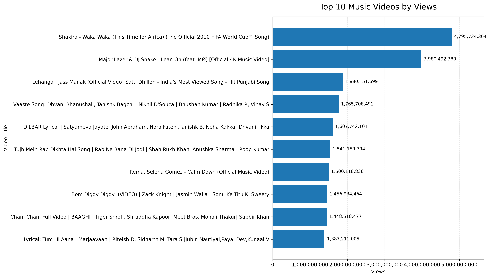
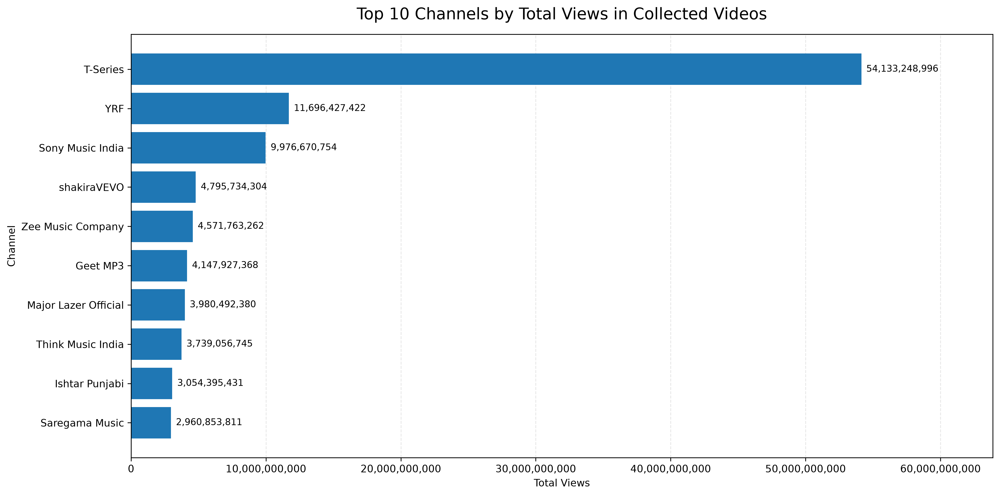
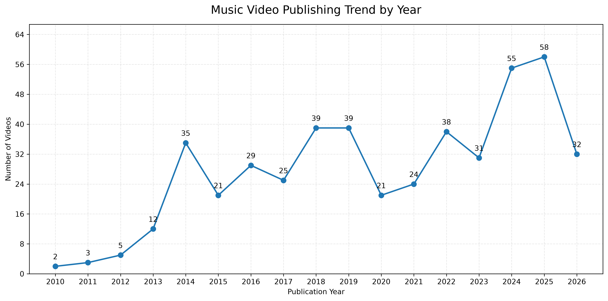

# Indian Music Trends Analysis

## Project Overview
This project analyzes YouTube music-video data collected using the YouTube Data API v3. Python and Pandas are used to clean and analyze the data, while Matplotlib and Seaborn are used to visualize view counts, channel performance, publication-year patterns, and audience engagement.

## Objectives
- Analyze the popularity of collected music videos using view counts.
- Identify channels with the highest combined views in the dataset.
- Explore video publication patterns by year.
- Calculate like rates and comment rates to understand audience engagement.
- Visualize relationships between views, likes, and like rates.

## Tools and Technologies
- **Python** — data collection and analysis
- **Pandas** — data cleaning and manipulation
- **Matplotlib and Seaborn** — data visualization
- **YouTube Data API v3** — video metadata and statistics
- **VS Code** — development environment
- **Git and GitHub** — version control and project hosting

## Dataset
The final dataset contains **469 music videos** collected from YouTube searches focused on Indian music and related categories.

Fields include:
- Video title
- Artist/channel name
- Publication date
- Views
- Likes
- Comments
- Video URL

**Note:** The dataset is a search-based sample, not a complete catalog of Indian music or an official music chart. Some international music videos may remain in the sample, and view and engagement counts reflect the time of collection.

## Key Findings
- **Videos analyzed:** 469
- **Total views:** 142.69 billion
- **Average views per video:** 304.23 million
- **Median views per video:** 170.21 million
- **Total likes:** 823.31 million
- **Total comments:** 20.53 million
- **Top channel by combined views:** T-Series
- **Year with the most collected videos:** 2025, with 58 videos
- **Average like rate:** 0.75%
- **Average comment rate:** 0.019%

These findings describe only the collected sample and should not be interpreted as rankings of all YouTube music videos.

## Analysis and Visualizations

### Top 10 Videos by Views

### Top 10 Channels by Total Views

### Videos by Publication Year

## How to Run
1. Install Python.
2. Install the required packages:
   `pip install pandas matplotlib seaborn google-api-python-client python-dotenv`
3. Configure your YouTube API key in a local `.env` file:
   `YOUTUBE_API_KEY=your_api_key_here`
4. Run the analysis scripts using Python, for example:
   `python eda_analysis.py`
   `python visualization.py`
   `python engagement_analysis.py`
   `python engagement_visualization.py`
   `python key_findings.py`

The data-collection script requires a valid YouTube Data API v3 key. Analysis scripts require the final CSV dataset to be present in the project folder.

## Security
Do not upload your `.env` file or expose your YouTube API key. The `.gitignore` file excludes `.env` from version control.

## Future Improvements
- Expand the dataset using additional search terms and pagination within API quota limits.
- Improve classification to separate Indian-language music from international content.
- Compare music categories, publication periods, and engagement metrics.
- Develop an interactive dashboard using Power BI.
